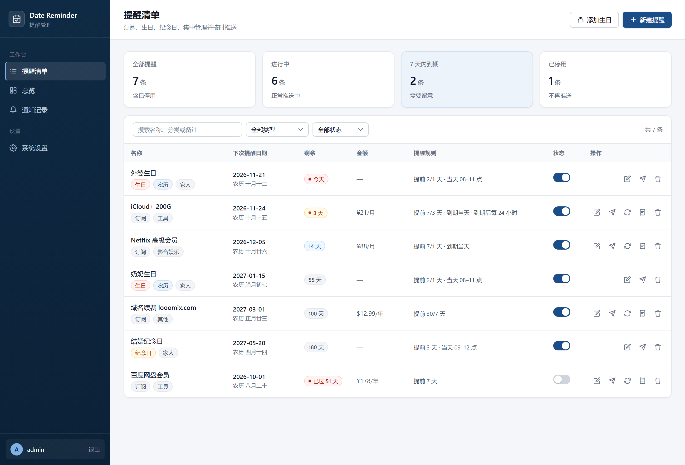

# Date Reminder

> 一个跑在 Cloudflare 上的「重要日子提醒」小系统：订阅到期、长辈生日、纪念日，到点自动推到**微信 / 企业微信 / QQ / 邮件 / Telegram**。

生日支持**农历**，可以设置「提前 2 天、提前 1 天、当天上午 8–11 点」这样的组合提醒。数据存在你自己的 Cloudflare 账号里，不经过任何第三方服务器。

**新手请直接看 👉 [部署教程.md](./部署教程.md)**（全网页操作，不需要懂代码）。



---

## 它能做什么

| 能力 | 说明 |
|---|---|
| 订阅 / 会员到期提醒 | 记录金额、周期、到期日，到期前自动提醒，支持一键续订并生成缴费记录 |
| 生日 / 纪念日提醒 | 每年自动重复，支持**农历**（含闰月、腊月三十遇小月按廿九），可显示周岁 |
| 多规则提醒 | 一条事项可配多条规则：提前 N 天 / 当天 / 到期后每 N 小时 |
| 发送时间段 | 任意规则都能限定「只在 08–11 点发」，当天只发一次，不刷屏 |
| 五种通知渠道 | 微信推送、QQ 机器人、企业微信群机器人、邮件、Telegram，可同时开多个 |
| 通知与调度日志 | 每次发送、每轮定时检查都有记录，排查「为什么没收到」 |
| 备份与恢复 | 一键导出 JSON，换账号 / 迁移时导入即可 |
| 深色模式 | 商务风格界面，浅色 / 深色 / 跟随系统 |

## 五种提醒方式怎么选

| 渠道 | 消息落到哪里 | 需要准备 | 适合 |
|---|---|---|---|
| **微信推送（PushPlus）** | 微信服务号「pushplus 推送加」 | 微信扫码登录拿 token（**长期有效**） | 个人使用，**最推荐**，给家人也最省事 |
| **QQ 机器人（PushPlus）** | QQ 私聊 / QQ 群 | 同一个 token + 在 PushPlus 绑定机器人 | 习惯用 QQ；已有 QQ 机器人可直接绑定 |
| **企业微信群机器人** | 企业微信群 | 群机器人 Webhook | 家庭群 / 团队群共享提醒 |
| **邮件** | 任意邮箱（QQ / 163 / 126 / Gmail 都行） | **自己的邮箱 + 授权码**（推荐，无需域名）；或 Resend / Brevo 的 API Key | 想留一份书面记录，或当作兜底渠道 |
| **Telegram** | Telegram 私聊 / 群 / 频道 | Bot Token + Chat ID | 常用 Telegram，免费且不限量 |

> **微信和 QQ 共用一个 token**：微信 + QQ 都走 PushPlus，注册一次、复制一个 token，
> 两个渠道各自开关、各自测试即可——不用再自己搭 OneBot、配公网地址，也不存在
> 「access_token 7200 秒过期」的问题。
>
> 多个渠道可以同时开启，一条提醒会并发发到所有已启用的渠道。

**关于邮件，两件事分开看：**

- **收件人**用哪个邮箱都行 —— QQ、163、126、Gmail、Outlook、公司邮箱，填进「收件邮箱」即可，不用任何设置
- **发件方**有三种选择：① 用你自己的邮箱（填服务器 + 授权码，Workers 直接连 SMTP，不经过第三方，也不需要域名，**推荐**）；② Resend（注册即用，用它的测试地址时只能发给自己）；③ Brevo（额度更大，不需要域名）

> 唯一注意：填的是邮箱后台生成的**授权码**，不是登录密码。

每个渠道右侧有独立开关，填完可以点「发送测试」先验证，收到了再保存。

## 界面

```
/admin                 提醒清单：增删改查、启用停用、测试发送、续订、缴费记录
/admin/dashboard       总览：支出统计、即将到期、定时任务状态、渠道状态
/admin/notify-logs     通知记录：发送明细 + 每小时调度日志
/admin/config          系统设置：通知渠道、发送时段、账号密码、备份
```

## 提醒规则怎么理解

```
提前 7 天        →  剩余天数「正好等于 7」的那天发一次，不会每天连发
当天             →  到期当天发一次，可限定只在 08–11 点发
到期后每 24 小时  →  过期未处理时反复提醒，直到你续订
```

生日 / 纪念日的推荐预设（点一下就生成）：

```
提前 2 天（全天） · 提前 1 天（全天） · 当天（08:00–11:00，只发一次）
```

普通订阅的推荐预设：`提前 7 / 3 / 1 天 + 当天`。

## 技术栈

- **Cloudflare Workers**（运行时）+ **KV**（存储）+ **Cron Triggers**（每小时检查）
- **Hono** 路由，原生 JS 前端（无构建步骤、无外部 CDN 依赖）
- 农历换算为内置算法（1900–2100），不依赖第三方接口

## 目录结构

```
src/
  index.js              Worker 入口（fetch + scheduled）
  app.js                Hono 应用装配
  api/                  路由与接口处理器
  core/                 农历、时间、币种、生日推算
  data/                 订阅 / 规则 / 日志 / 配置的 KV 读写
  services/
    notify/             通知渠道（pushplus / pushplusqq / wechat / email / telegram）
    scheduler.js        每小时到期检查
  views/                页面（服务端直出 HTML）
public/                 静态资源（favicon）
assets/                 README 配图
tests/                  单元与集成测试
```

## 本地开发

```bash
npm install
npx wrangler dev --config wrangler.dev.toml
# 打开 http://localhost:8787 ，默认账号 admin / password
```

如果熟悉命令行，也可以用 `npm run setup` 自动创建 KV 并把 id 写进 `wrangler.toml`（需先 `npx wrangler login`），再 `npx wrangler deploy` 上线——效果与网页端部署一致。

## 安全说明

- 通知密钥只存在 Cloudflare KV 里，前端接口返回时会被替换成 `*_CONFIGURED` 标记，不会明文下发。
- 首次登录后请立刻在「系统设置 → 账号与安全」里改掉默认密码。
- 仓库里**不要**提交 `.env`、`.dev.vars` 或任何真实密钥（`.gitignore` 已排除）。

## 许可

MIT
